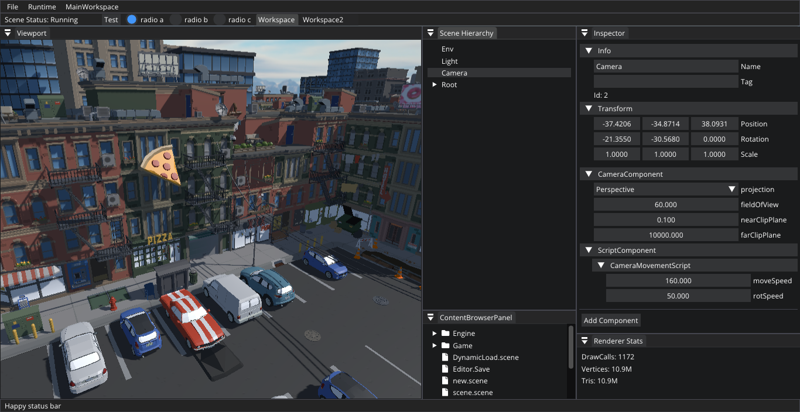
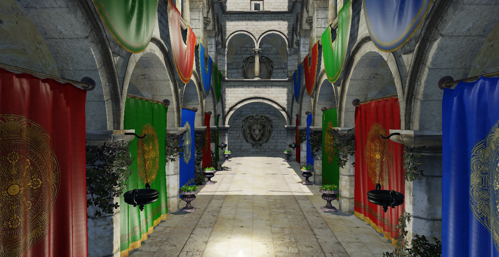
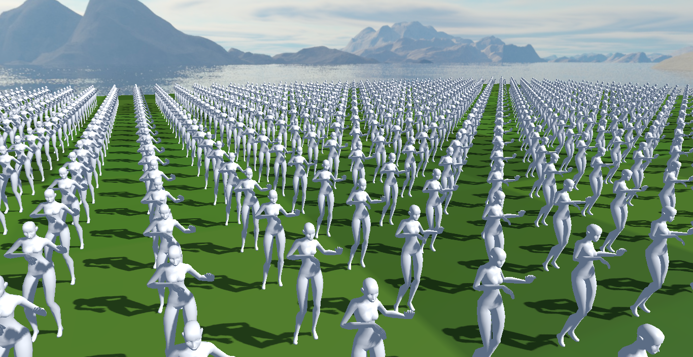

# My Nameless Game Engine

In developement Game Engine inspired by The Unity Engine, write in c++ with focuses on high performace, be small and easy to use 

### Screenshots





### How Compiler And Run with Visual Studio Compiler

cmake -S . -B build

cmake --build build --config Release

./build/Release/Sandbox

### Live editor commands

See [Engine commands](Engine/Docs/engine-commands.md) for the full quick reference, including one-shot screenshots.

Build your project and the `onedude` target. Add the output directory to your
PATH or run the commands from that directory. Launch your project in one terminal
with the flag below.

```text
Sandbox --live-commands --mode edit
```

Use `onedude` from another terminal to control the running session.

```text
onedude status
onedude list --json
onedude command scene open Sandbox/Scenes/PBR.scene
onedude command play
onedude command capture-viewport play.png
onedude command stop
```

`--live-commands` works with any project that uses `OD/Entry.h`. Projects
with a custom entry point can call `OD::Application::SetArgs(argc, argv)`
before reading project arguments. When several sessions are open, the CLI
uses the project directory to choose a session and prompts
for `--pid <pid>` if the choice is ambiguous. Scene paths resolve within the
project's Content directory. Screenshot paths resolve from your terminal's
directory. The CLI returns `0` on success, `1` if the engine rejects the
command, and `2` if the CLI or connection fails.

Windows uses a same-user named pipe. Linux uses a Unix domain socket in a
private user directory. Neither transport listens on a network port.

Modules can register commands in `OnInit` with `OD::LiveCommands::Register`
from `OD/Core/LiveCommands.h`. Handlers run on the application thread and can
reply in a later frame. Commands are removed with their owning module.

### Current Features
* ECS 
* JobSystem
* 3D Renderer, PBR, Lights, Shadow, Forward Rendering
* 3D Physics
* Dear ImGui Support
* Editor
* Native Scripting
* Dynamic Module 
* Audio
* Navmesh
* Platform (Windows Desktop)
* Graphic Api (Opengl 4.6)

### Planned Features

* Lua Scripting
* Global Illuminations 
* Seamless C++ scripting | c++ hot reloading 
* 2D Features(Sprite, Tile map)
* Double Precision
* GPU Driver Renderer
* Vulkan Support

### Roadmap

[See the Roadmap to Version 1.0](Roadmap.md)

# Lean References

* [Unity Engine](https://unity.com/)
* <https://learnopengl.com/>
* <https://catlikecoding.com/unity/tutorials/custom-srp/>
* <https://www.youtube.com/@TheCherno>
* [Book: Hands-On C++ Game Animation Programming](https://subscription.packtpub.com/search?query=hands%20on%20game%20animation%20programming)
